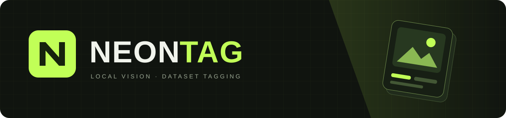
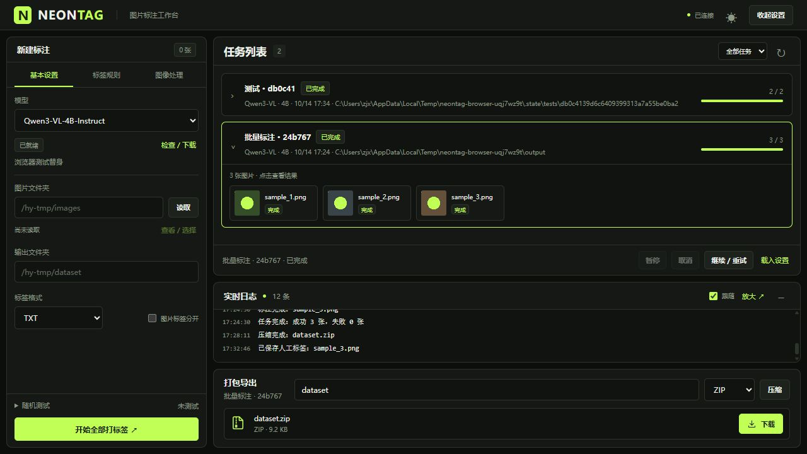
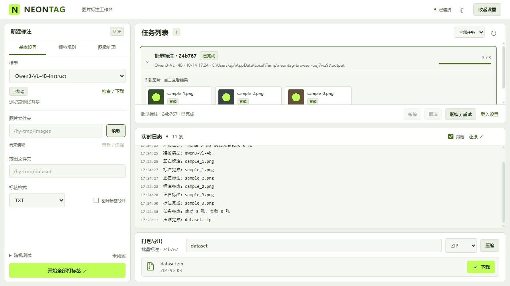

<div align="center">



**用本地视觉模型，把图片整理成可用的数据集。**


[快速开始](#快速开始) · [使用指南](docs/usage.md) · [更新与推送](docs/git-guide.md)

</div>



<details>
<summary>☀️ 查看日间主题</summary>



</details>

## 能做什么

| 功能 | 说明 |
| :--- | :--- |
| 🧠 本地模型 | 预设 Qwen3-VL 4B / 8B，缺失可下载；支持指定本地 Qwen2 / 2.5 / 3 VL 目录 |
| 🖼️ 图像整理 | 等比例缩放、统一命名、JPG / PNG / WEBP，原图自动备份 |
| 🏷️ 标签规则 | 自定义提示词、最少标签数、前置触发词，输出 TXT / JSON / CSV |
| 🔍 测试与审核 | 随机抽图确认后测试；任务展开看图片，左图右标签，可编辑保存 |
| ⏯️ 任务恢复 | 实时日志、暂停 / 取消 / 继续，重启后恢复任务 |
| 📦 干净导出 | 图片与标签合放或分开，ZIP / TAR.GZ / RAR 打包后直接下载 |

## 快速开始

Linux 服务器，建议 **Python 3.11 / 3.12 + NVIDIA GPU**。

```bash
git clone https://github.com/SSXXXzjx/NeonTag.git
cd NeonTag
python -m venv .venv
source .venv/bin/activate
python -m pip install -r requirements.txt -i https://pypi.tuna.tsinghua.edu.cn/simple
python main.py
```

浏览器访问 **`http://服务器IP:8080`**，服务监听 `0.0.0.0:8080`。

1. 选择模型并检查 / 下载，或输入服务器本地模型目录。
2. 读取图片文件夹，设置一个新的空输出目录。
3. 按需调整标签规则，先随机测试，再开始批量标注。
4. 展开任务审核结果，完成后压缩并下载。

> 所有路径均为**服务器上的路径**。模型保存在 `models/`，任务记录、测试和备份放在 `.state/`；正式输出只包含图片与标签。

## 模型

预设模型可在页面下载，也可手动下载到项目目录：

```bash
modelscope download --model Qwen/Qwen3-VL-4B-Instruct --local_dir ./models/Qwen3-VL-4B-Instruct
modelscope download --model Qwen/Qwen3-VL-8B-Instruct --local_dir ./models/Qwen3-VL-8B-Instruct
```

本地目录支持 Qwen2-VL、Qwen2.5-VL、Qwen3-VL 标准 BF16 / FP16 safetensors 权重。暂不支持 AWQ / GPTQ / GGUF 预量化模型。4B / 8B 半精度权重约占 8GB / 16GB，推理还需额外显存；完整环境说明见[使用指南](docs/usage.md)。

<details>
<summary>部署与验证</summary>

- 推荐在可信网络或端口转发下使用；当前没有登录系统。
- GPU 需安装适配驱动及 CUDA 版 PyTorch；RAR 需系统安装 `rar`。
- 界面截图使用测试图片。自动测试使用推理替身，真实 GPU 推理需在目标服务器验证。

```bash
python -m unittest discover -s tests -v
node tests/test_frontend.cjs
```

[验证记录](docs/verification.md) · [详细使用指南](docs/usage.md) · [如何更新代码](docs/git-guide.md)

</details>
